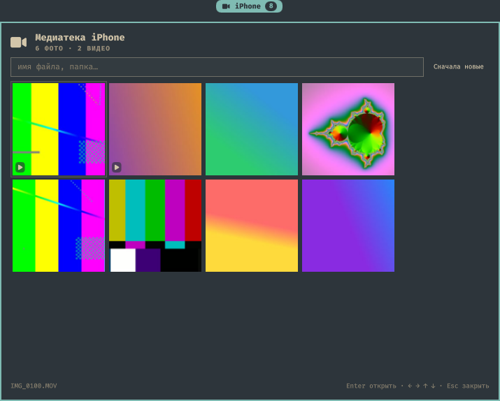
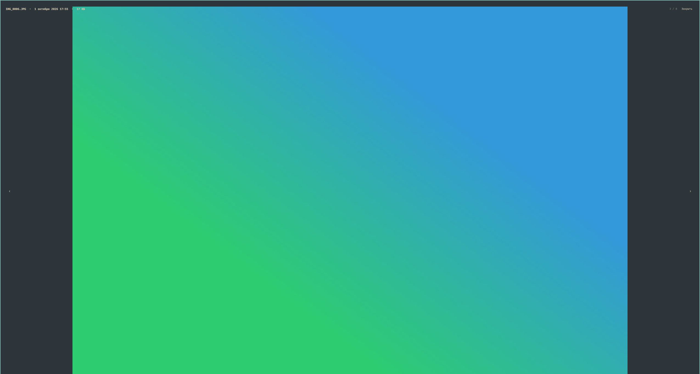

# Omaimediateka

> A **read-only** photo and video gallery for [Omarchy](https://omarchy.org/) Shell
> (Quickshell): browse `DCIM` from a USB-connected iPhone or Android phone in a bar
> popup — no import, no deletion, no cloud.

[Русская версия →](README.ru.md)



The widget is one pill in the center of the Omarchy bar. Clicking it opens a popup
with a lazy-loaded preview grid of every photo and video under `DCIM`, a live filter,
and a fullscreen viewer. Access is local and read-only: an iPhone is mounted by
`gvfs-afc` and an Android phone by `gvfs-mtp` over the USB cable, and the path
disappears automatically when it is unplugged.

## Features

- **Bar pill** — `Omaimediateka · —` when no phone is connected, `iPhone 15 Pro · N` /
  `Android Pixel 8 · N` when one is (N = media files found). The model comes from
  `ideviceinfo -k ProductType` (mapped to a marketing name; unknown types are shown
  as-is) or from the MTP/USB name; if it cannot be determined, just `iPhone`/`Android`.
  Long names are truncated with “…” so the bar keeps its layout.
- **iPhone and Android** side by side: the popup shows the device type and name; if
  both are plugged in, a switcher in the popup picks which one to browse (the
  ready device is shown first, the iPhone wins a tie).
- **Preview grid** over every `DCIM` subfolder (`100APPLE`, `101APPLE`, …).
- **Lazy thumbnails** — generated on demand for visible cells, one decode at a time,
  cached on disk and invalidated by size/mtime.
- **Fullscreen viewer** — photos fit the screen; videos play inline through
  QtMultimedia. `←/→` navigates, metadata (name, date, size, duration) is shown.
- **Live filter** by file name or folder, plus **content search** over Apple's
  on-device index (localized scene/OCR tokens, scene and action labels from
  `MediaAnalysis`, and English captions, including per-segment video captions)
  with a per-cell source badge, and newest-/oldest-first sorting.
- **Export** (read-only on the phone): save the original to `~/Pictures/iPhone`
  (`Ctrl+S`) or pick a folder (`Ctrl+Shift+S`); existing names get a ` (1)`, ` (2)`
  suffix instead of being overwritten. `Ctrl+C` puts a photo in the clipboard as
  `image/png` (HEIC is decoded with `heif-convert`), or a video's path as text.
- **Batch selection**: `Space`, the checkbox, or `Ctrl`+click selects cells,
  `Ctrl+A` selects all visible; the export buttons then act on the whole selection.
- **Clear states** instead of a blank screen: phone not connected, not trusted,
  `gvfs-afc`/`gvfs-mtp` missing, no `DCIM`, locked or “charging only” Android,
  mounting in progress.



## Requirements

- **Omarchy** with the Quickshell shell plugins API (tested with Omarchy 4.0.x,
  Quickshell 0.3.1).
- **`gvfs-afc`** — the AFC backend that exposes the iPhone as files.
- **`gvfs-mtp`** — for Android phones (MTP, no root and no ADB needed).
- **`libimobiledevice`, `libusbmuxd`, `usbmuxd`** — device detection and pairing.
- **`libheif`** (`heif-convert`) — required for HEIC photos. System `ffmpeg` is built
  without a HEIF demuxer and Qt's imageformats has no HEIC plugin, so HEIC stills are
  converted with `heif-convert` before thumbnailing.
- **`ffmpeg` / `ffprobe`** — JPEG/PNG/WebP thumbnails, video posters and duration.
- **`qt6-multimedia-ffmpeg`** (optional) — in-widget video playback.
- **`wl-clipboard`** (`wl-copy`) — copying to the clipboard (`Ctrl+C`).
- **`zenity`** or **`kdialog`** (optional) — the “Save as” folder picker.
- **`python3`** — builds and queries the compact content-search index. Without it
  the name/folder filter and everything else still work; only content search is off.

On Arch:

```bash
sudo pacman -S gvfs-afc gvfs-mtp libimobiledevice usbmuxd libheif ffmpeg qt6-multimedia-ffmpeg
```

Only install what you use: `gvfs-afc` + `libimobiledevice` + `usbmuxd` for an iPhone,
`gvfs-mtp` for an Android phone.

## System setup (one time)

```bash
sudo pacman -S gvfs-afc
sudo systemctl start usbmuxd     # usually started automatically by udev on plug-in
```

Then connect the iPhone, unlock it, and tap **Trust** on the phone.

Sanity check:

```bash
idevice_id -l                          # prints the device UDID
idevicepair -u <UDID> validate         # SUCCESS: Validated pairing
ls "$XDG_RUNTIME_DIR"/gvfs/afc:host=*  # DCIM/ appears
```

The widget never runs `sudo`: mounting is handled by the user session via gvfs.

### Android (MTP)

```bash
sudo pacman -S gvfs-mtp
```

Then plug the phone in, unlock it, and on the phone open the USB notification
(“Charging this device via USB” / “USB for file transfer”) and choose
**File transfer** (MTP). In “Charging only” mode the phone does not expose its files;
the popup says so (“Только зарядка”) and tells you what to tap. Authorize the
computer if the phone asks.

Sanity check:

```bash
gio mount -l | grep -i mtp                                    # the phone is listed
ls "$XDG_RUNTIME_DIR"/gvfs/mtp:host=*/*/                      # DCIM, Pictures, ...
```

Media is read from `DCIM` (including `DCIM/Camera` and `DCIM/Screenshots`) and
`Pictures` on every storage the phone exposes (internal storage and an SD card, if
any). Close other apps that hold the MTP connection (Android File Transfer-style
tools, a file manager showing the phone), as only one client can use it at a time.

## Install

```bash
git clone https://github.com/salehardec/omaimediateka.git
cd omaimediateka
./install.sh
```

`install.sh` copies the plugin into `~/.config/omarchy/plugins/omaimediateka/`
(the directory comes from the `id` in `manifest.json`).

Enable the widget by adding it to the center section of `~/.config/omarchy/shell.json`:

```json
{
  "bar": {
    "layout": {
      "center": [
        { "id": "omaimediateka" }
      ]
    }
  }
}
```

Then restart the shell:

```bash
omarchy restart shell
```

Uninstall with `./install.sh --uninstall`.

## Usage

| Action | Key / control |
|---|---|
| Open / close popup | click the bar pill |
| Move in the grid | `← → ↑ ↓` or `hjkl` |
| Open fullscreen | `Enter`, `Space`, or click |
| Filter | start typing; `Esc` in the field clears it (Android: also by date, e.g. `2026-10-13` or `13 октября`) |
| Search by content | type a word after “Обновить поиск” has built the index; the badge shows the source |
| Rebuild the search index | the “Обновить поиск” button in the header |
| Sort | the “newest / oldest first” button |
| Previous / next in viewer | `← →` or the side buttons |
| Video play / pause | `p`, `Space`, or the button |
| Select / deselect a cell | `Space`, the checkbox, or `Ctrl`+click |
| Select all visible | `Ctrl+A` |
| Save to `~/Pictures/iPhone` (`~/Pictures/Android` for Android) | `Ctrl+S` or the “Сохранить” button |
| Save as (pick a folder) | `Ctrl+Shift+S` or the “Сохранить как” button |
| Copy to clipboard | `Ctrl+C` — photo as image, video as path |
| Clear selection | `Esc` or the “Снять выбор” button |
| Back to grid | `Esc` |
| Close popup | `Esc` (from the grid) |

## How it works

- **Access** — `gio mount afc://<UDID>/` mounts the phone through `gvfs-afc`; the
  files are then readable at `$XDG_RUNTIME_DIR/gvfs/afc:host=<UDID>/`. Unplugging
  the cable removes the path, and the widget falls back to “not connected”.
- **Android** — `gio mount mtp://<host>/` mounts the phone through `gvfs-mtp` at
  `$XDG_RUNTIME_DIR/gvfs/mtp:host=<host>/<storage>/`. The helper reads `DCIM` and
  `Pictures` of every storage; hidden entries (`.thumbnails`, `.trashed-*`) are
  skipped. MTP through gvfs is slower than AFC, so the last full listing is cached
  in `~/.cache/omaimediateka/lists/` and shown instantly on reconnect while a fresh
  scan runs in the background (the header says “обновление…”). Thumbnails are
  generated from the originals one at a time, as for the iPhone; a video must be
  fetched from the phone before its poster can be taken.
- **`bin/oma-mediateka`** is the only component that knows about the backend:
  - `status [iphone|android]` — detects devices, trust/transfer mode and mount (one
    JSON line: `state`, `type` = `iphone`/`android`/`none`, `name`, `model`, `id`, `roots`, and
    a `devices` list of everything found);
  - `list [--cache KEY] <dir>...` — a single `find` pass over media files in one or
    more roots (TSV); `list-cached <KEY>` prints the last saved listing;
  - `thumb <src> <dst> <kind> [thumb|preview]` — renders a JPEG preview into the cache;
  - `meta <src>` — video duration and dimensions;
  - `names <dir>` / `copy <src> <dst>` — export: list existing names, then copy the
    original (refuses to overwrite; the UI adds the ` (1)`, ` (2)` suffix);
  - `clip-image <src>` / `clip-text <text>` — clipboard through `wl-copy`;
  - `pick-dir [start]` — folder picker (`zenity`, else `kdialog`);
  - `index [mount]` — copies the phone's Apple search databases (read-only) and
    builds/refreshes the compact search cache (incremental, with progress);
    refuses (exit 5) for Android;
  - `search <query>` — `path<TAB>source<TAB>matched` rows from that cache.
- **Cache** — `~/.cache/omaimediateka/thumbs/` and `.../previews/`. Keys include the
  file size and mtime (and, for Android, the device id, so files with the same name
  on two phones never collide); changed files are re-rendered and unchanged ones are
  reused.
- **Content search** — the helper copies `Photos.sqlite` and `MediaAnalysis.sqlite`
  into `~/.cache/omaimediateka/apple-index/` and turns Apple's Leo lexeme index,
  `MediaAnalysis` scene/action/pet labels and Vision captions (whole-asset and
  per-segment video captions) into a compact `search.sqlite` (`asset`, `token`,
  `caption`). BLOB and NSKeyedArchiver parsing runs in `bin/oma-mediateka-index.py`.
  The index is refreshed incrementally when the phone is reconnected (or on
  demand), so browsing never waits for it. Russian tokens are stemmed and matched
  by prefix, English captions by word prefix, and name/folder matches are merged
  in. Search results collapse a Live Photo's HEIC+MOV into the photo and rank
  elements by how many content sources matched; low-confidence labels are dropped.
- **Sorting** — iPhone: by Apple’s file numbering (folder + number), which is
  chronological even when gvfs `mtime` is unreliable, with mtime as a tie-breaker.
  Android: by file modification time (`mtime`), as Android names carry no sequence.

Design notes (in Russian): [`docs/superpowers/specs/2026-10-01-iphone-media-plugin-design.md`](docs/superpowers/specs/2026-10-01-iphone-media-plugin-design.md).

## Limitations

- **Read-only on the phone.** Nothing is ever deleted or modified on the iPhone or
  Android phone; export only copies originals out.
- Export **never overwrites**: a name already present gets a ` (1)`, ` (2)`, … suffix.
- The **interface is currently in Russian**; the code and this README are in English.
  Localization PRs are welcome.
- Sorting follows Apple’s file numbering (iPhone) or file mtime (Android), **not EXIF
  capture date**.
- **Android has no content search.** There is no on-device index like Apple’s, so
  the popup says “поиск по содержимому недоступен” and the filter matches the file
  name, folder and date only (`2026-10-13`, `13.10.2026`, `13 октября`, `октябрь 2026`).
  Recognition on our side is deferred. The “Обновить поиск” button is hidden.
- Android: MTP over gvfs is slow on big libraries (the first listing and every video
  poster can take a while); only `DCIM` and `Pictures` are scanned; RAW/DNG and
  motion-photo extras are not shown separately; the phone must stay unlocked and in
  File transfer mode. Detecting “charging only” relies on the USB vendor id of common
  Android makers, so an unusual make is reported as “not connected” instead.
- **Live Photos** show up as two separate items in the grid (a HEIC and a MOV);
  in content-search results the pair is collapsed to the photo.
- **Content search** reuses an undocumented Apple index: ~99.5 % of assets are
  covered, assets stored only in iCloud are skipped (no local file), and an iOS
  update may change the schema — in which case search degrades gracefully to
  name/folder filtering. If the iPhone gets locked or is on a call mid-index, the
  copy is retried three times and the status line then shows “Нет доступа к
  телефону: разблокируйте iPhone, завершите звонок и повторите”; the previous
  index keeps working.
- The content index is built per device in `~/.cache/omaimediateka/` and refreshed
  when the phone reconnects; the first build copies ~330 MB over USB (~15 s).
- One phone at a time: with both an iPhone and an Android phone plugged in, use the
  switcher in the popup (the ready device is shown first). Two phones of the same
  kind: the first detected wins.
- `ifuse` is not used. The backend is isolated in `bin/oma-mediateka`, so adding it
  later would not touch the QML.

## Development

```bash
node test/MediaModel.test.js        # pure model: listing, sorting, filtering, search merge, Android dates
python3 test/test_index.py          # cache build: BLOBs, actions, thresholds, migration
python3 test/test_android.py        # Android/iPhone helper on a mocked gvfs tree (no phone needed)
bash -n bin/oma-mediateka           # helper syntax
python3 -m py_compile bin/oma-mediateka-index.py   # indexer syntax
./bin/oma-mediateka status          # with no phone: state=no-device
```

Repository layout:

```
manifest.json      # id, kinds: bar-widget, entryPoints.barWidget
Panel.qml          # bar pill + popup: grid, filter, fullscreen viewer
VideoView.qml      # QtMultimedia player, imported in isolation
MediaModel.js      # pure, node-testable model
bin/oma-mediateka  # status | list | thumb | meta | … | index | search
bin/oma-mediateka-index.py  # content-search cache build + query (python3)
install.sh         # install / uninstall
test/              # node tests for the model, python tests for the index and the helper
docs/              # design spec, research notes and screenshots
```

## License

MIT — see [LICENSE](LICENSE).
